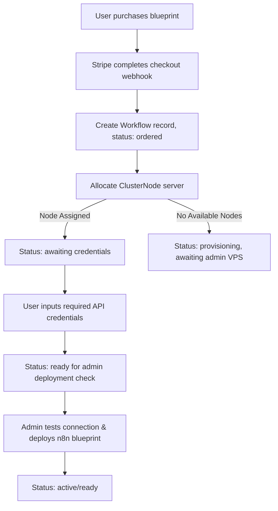

# BLONK | Project Documentation & System Architecture

Welcome to **BLONK**, a sovereign, decoupled workflow execution platform built specifically for professional services firms. Unlike traditional SaaS automation tools that route proprietary business logic and client data through external servers, BLONK is designed to let organizations own and run their automations locally or on private cloud instances, achieving 100% data sovereignty.

---

## 📖 Table of Contents
1. [Core Philosophy & Value Prop](#-core-philosophy--value-prop)
2. [Key Features & Modules](#-key-features--modules)
3. [Technology Stack](#-technology-stack)
4. [Database Schema & Architecture](#-database-schema--architecture)
5. [Directory Structure Walkthrough](#-directory-structure-walkthrough)
6. [Operational Workflows & Provisioning Engine](#-operational-workflows--provisioning-engine)
7. [Scripts & Utility Tools](#-scripts--utility-tools)
8. [Security & Compliance](#-security--compliance)

---

## 🎯 Core Philosophy & Value Prop

BLONK empowers enterprise customers to decouple their automated workflows from vendor-locked SaaS ecosystems. Its key architectural principles are:

*   **Decoupled Architecture**: Customers license and download standardized execution blueprints (n8n JSON config files) and run them on their own private servers, nodes, or hybrid clusters.
*   **100% Data Sovereignty**: All data processes route directly through customer-owned environments. This provides built-in alignment with stringent regulatory frameworks like HIPAA, SOC-2, and GDPR.
*   **Zero Markup Execution**: By executing workflows directly on their own instances, organizations communicate with AI systems (e.g., OpenAI, Google Gemini) and external tools directly, bypassing third-party platform markups.
*   **Modifiable Logical Canvas**: Blueprints are fully editable on n8n's visual node grids, allowing internal IT and GRC (Governance, Risk, and Compliance) teams to audit or customize logic.

---

## ⚙️ Key Features & Modules

### 1. Marketing & Showcase Layouts
*   **Dynamic Landing Page**: Showcases the value proposition, live node visualizer simulation, catalog of standard workflows, and pricing tiers.
*   **No-Subscription Model**: Focuses on one-time payments for lifetime blueprint licenses (Single Licenses or the Institutional Pack).
*   **Service & Sector Insights**: Detailed pages highlighting how sovereign automation applies to sectors like finance, legal, operations, and healthcare.

### 2. Member & Team Dashboards
*   **Dedicated Cluster Nodes**: Users can monitor their assigned dedicated n8n VPS servers.
*   **Connections & Credentials Management**: Secure storage settings for integration keys (e.g., Google, Slack, Stripe, OpenAI).
*   **Workflow Operations**: Track the setup progress, execution metrics, logs, and performance statistics of active automations.
*   **Notification Center**: Real-time high-stakes alerts on node deployments, connection requests, and system health status.
*   **Incident Logging & Support**: Built-in support ticketing and operational health metrics.

### 3. Administration Dashboard (Sovereign Operations)
*   **Fleet Control (Cluster Nodes)**: Admin overview of active, provisioning, and unassigned servers in the infrastructure.
*   **Order Pipeline**: Direct view of customers purchasing licenses, allowing admin provisioning confirmation.
*   **Audit Logging**: Full audit trail of database operations, login attempts, configuration changes, and incident triggers.
*   **User Management**: Role and permissions configuration (Admin, Owner, Member) and onboarding state controls.
*   **System Diagnostics**: Live dashboard reporting system uptime, average response latency, CPU loads, and active integrations.

---

## 🛠️ Technology Stack

BLONK is built as a modern full-stack web application leveraging:

| Component | Technology | Description |
| :--- | :--- | :--- |
| **Framework** | Next.js 16 (App Router) | React 19 framework handling client-side views and API route endpoints. |
| **Language** | TypeScript | Strong typing for route parameters, lifecycle hooks, and database models. |
| **Database** | PostgreSQL | Relational transactional database accessed via the raw `pg` pool connector. |
| **Authentication** | NextAuth.js | Credentials-based login (bcrypt hashed passwords) and Google OAuth provider. |
| **Styling** | Tailwind CSS & CSS Modules | Unified UI elements backed by modular, scoped layout sheets. |
| **AI Integration** | Vercel AI SDK | Native integrations with OpenAI and other LLM services. |
| **Payments** | Stripe API | Checkout sessions and webhook validation for licenses and system bundles. |
| **Emails** | React Email & Nodemailer | Transactional emails formatted as React elements and dispatched via SMTP. |

---

## 🗄️ Database Schema & Architecture

The database runs on PostgreSQL and is initialized via `scripts/schema.sql`. It relies on several key tables:

*   `User`: Institutional user profiles, password hashes, roles (`ADMIN`, `OWNER`, `MEMBER`), team bindings, and onboarding statuses.
*   `Event`: Analytics tracking system recording actions (e.g., page views, checkouts, logins) for attribution.
*   `Payment`: Ledger recording checkout amounts, status, and linked Stripe session identifiers.
*   `MarketingSpend`: Administrative entries for tracking Customer Acquisition Cost (CAC).
*   `Workflow`: The core execution records. Links a customer's workspace to a designated VPS, tracking provisioning status (`Ordered`, `Provisioning`, `Awaiting_Credentials`, `Ready`, `Error`).
*   `WorkflowTemplate`: The blueprints library details containing description, setup guides, and third-party integration requirements.
*   `WorkflowLog`: Historical execution records reporting n8n job outcomes.
*   `ClusterNode`: The list of VPS servers (assigned to specific teams or open for allocation).
*   `Notification`: System notifications pushing updates to members.
*   `Report` & `Transaction`: Financial snapshots and transactions ledger.
*   `OperationalSetting`: System settings and API configurations.

---

## 📁 Directory Structure Walkthrough

Below is a breakdown of the key files and directories:

```text
blonk/
├── .env                       # Environment credentials (DB URL, Stripe keys, Auth secrets)
├── Dockerfile                 # Containerization template for building next-app
├── docker-compose.yml         # Dev/Production container setup orchestration
├── components.json            # Configuration configuration for shadcn UI components
├── scripts/                   # System operations, database seeds, and migrations
│   ├── schema.sql             # Full database initialization DDL
│   ├── init-db.js             # Automated database validation and baseline seeding
│   ├── db-harden.js           # Password hardening and GRC security config script
│   ├── setup-orders.js        # Provisioning setups for new product pipelines
│   └── *_migrate.js           # Version-control migrations for workflows and VPS assets
├── src/
│   ├── app/                   # Next.js App Router root
│   │   ├── (marketing)/       # SEO-optimized landing, pricing, sector, and showcase routes
│   │   ├── admin/             # Operations dashboard for administrators
│   │   ├── api/               # Serverless API routes (auth, billing, nodes, telemetry, workflows)
│   │   ├── dashboard/         # Client workspace control panel
│   │   ├── layout.tsx         # Global provider initialization (auth, styling)
│   │   └── globals.css        # Main stylesheet defining design variables and colors
│   ├── components/            # Shared UI layout files
│   │   ├── bundui/            # Visual graph interfaces and canvas charts
│   │   ├── reui/              # Institutional form elements
│   │   └── ui/                # Core interactive elements (buttons, tables, cards)
│   ├── emails/                # React components for transactional email templates
│   └── lib/                   # Internal backend services and logic
│       ├── db.ts              # PostgreSQL connection pool and query engine wrapper
│       ├── auth.ts            # NextAuth providers configuration and JWT session hooks
│       ├── workflow-provision.ts # Server allocation and credential validation logic
│       ├── workflow-lifecycle.ts # Transitions state machine for automating setups
│       └── order-pipeline.ts  # Purchase validation and Stripe checkout integration
```

---

## ⚙️ Operational Workflows & Provisioning Engine

The platform manages the automatic setup of VPS nodes for clients who purchase workflow licenses:



This lifecycle is governed by:
*   [workflow-provision.ts](file:///c:/Users/prokn/Desktop/blonk/src/lib/workflow-provision.ts): Handles checking available server capacity (`ClusterNode` table) and binding servers to a client's team workspace.
*   [workflow-lifecycle.ts](file:///c:/Users/prokn/Desktop/blonk/src/lib/workflow-lifecycle.ts): Controls the state machine transitions and checks if the client has fulfilled all credentials requested by a template.
*   [order-pipeline.ts](file:///c:/Users/prokn/Desktop/blonk/src/lib/order-pipeline.ts): Resolves transactions, creates users if they are new, and provisions default environments.

---

## 💻 Scripts & Utility Tools

The `scripts` directory provides commands to setup and manage the app's backend:

*   **`node scripts/init-db.js`**: Connects to the database using `DATABASE_URL`, builds the tables defined in `schema.sql`, and seeds initial KPI and chart metric objects.
*   **`node scripts/db-harden.js`**: Runs administrative security operations on the users database, ensuring that passwords meet robust structural checks.
*   **Migrations**:
    *   `migrate.js`: Creates the necessary columns for tracking deployment states.
    *   `migrate-workflows-to-orders.js`: Transforms workflow records into order-centric trackers matching the updated order engine.
    *   `vps-migrate.js`: Sets up baseline `ClusterNode` infrastructure rows.

---

## 🔒 Security & Compliance

*   **Role-Based Access Control (RBAC)**: Enforced via NextAuth and route checks. `ADMIN` roles have access to `/admin` telemetry and config pages, while `OWNER` and `MEMBER` roles can only view and mutate their own workspace configuration within `/dashboard`.
*   **Credentials Encapsulation**: Integration keys are stored locally on the tenant's database schema, remaining entirely within their boundary instead of public shared tables.
*   **Data Minimization**: The platform strictly tracks metrics and logs required for system health, avoiding any inspection of the payloads processing inside the client's n8n containers.
